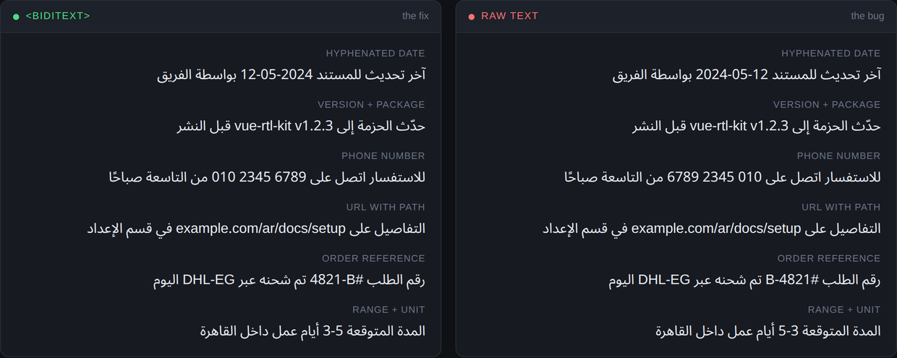
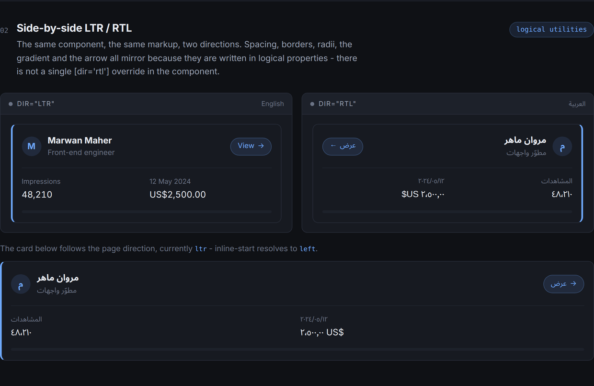
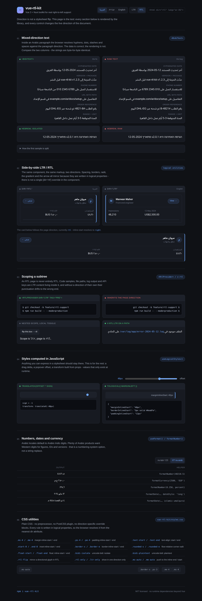

# vue-rtl-kit

[](https://github.com/MarwanMaher0/vue-rtl-kit/actions/workflows/ci.yml)
[](./LICENSE)
[](./src/types.ts)

Right-to-left support for Vue 3 and Nuxt — direction state that survives SSR, logical-property
utilities, and Unicode-isolated bidirectional text.

Most "RTL support" is a stylesheet flip. That covers layout and stops at the hard part: what the
browser does to your *text*.

---

## The bug this library exists for

Put a date, a version number, a phone number or a URL inside an Arabic sentence and the browser
renders it in the wrong order.

```
Data:      آخر تحديث للمستند 12-05-2024 بواسطة الفريق
Rendered:  آخر تحديث للمستند 2024-05-12 بواسطة الفريق
                             ^^^^^^^^^^ the day and the year have swapped
```

Nothing is wrong with the string. The Unicode Bidirectional Algorithm resolves *neutral*
characters — hyphens, dots, slashes, colons, spaces — against the direction of the surrounding
paragraph, so a Latin run sitting inside Arabic text gets reordered on the way to the screen.

That is why this one ships. The value in the database is right, the value in the API response is
right, the value in your unit test is right. Only the pixels are wrong, and only for readers of
the RTL locale.



Left panel, `<BidiText>`. Right panel, raw text. The strings are byte-for-byte identical:

| Data | Rendered raw | With `<BidiText>` |
| --- | --- | --- |
| `12-05-2024` | `2024-05-12` | `12-05-2024` |
| `010 2345 6789` | `6789 2345 010` | `010 2345 6789` |
| `#4821-B` | `B-4821#` | `#4821-B` |
| `3-5 أيام` | `5-3 أيام` | `3-5 أيام` |

The fix is an *isolate* — `U+2066 LRI` … `U+2069 PDI`, or its DOM equivalent `<bdi>` — which tells
the algorithm to resolve the run on its own terms and treat the result as a single neutral
character in the outer paragraph.

```vue
<!-- broken -->
<p>{{ message }}</p>

<!-- correct -->
<BidiText as="p" :text="message" />
```

`<BidiText>` does not wrap the whole string. It splits the text into directional runs and isolates
only the ones that would actually move, so a trailing comma stays with the Arabic sentence and a
bare `2024` — which reads the same either way — is left alone.

---

## Guide

- [Common RTL bugs in Vue apps and how to fix them](./docs/common-rtl-bugs.md) — physical CSS
  properties that do not flip, icons that must (and must not) mirror, Latin runs and punctuation
  breaking inside RTL text, mixed-direction form input, numbering systems, the SSR direction flash,
  transforms going the wrong way, third-party components that hardcode LTR, arrow-key navigation
  going backwards in tabs, sliders, carousels and menus, horizontal scrollers breaking on
  negative RTL `scrollLeft`, and popovers opening on the wrong side. Each bug has a minimal broken
  snippet, a plain CSS/Vue fix, and the vue-rtl-kit version.

## Install

```sh
npm install vue-rtl-kit
```

Vue 3.3+ on Node 20.11+. No runtime dependencies. For Nuxt, `@nuxt/kit` is an optional peer you already have.

### Module formats

| Entry point | ESM | CommonJS | Types |
| --- | --- | --- | --- |
| `vue-rtl-kit` | `import` | `require()` | `index.d.ts` / `index.d.cts` |
| `vue-rtl-kit/styles.css` | `import` | `require()` | `export {}` stub, so the import type checks without `declare module '*.css'` |
| `vue-rtl-kit/nuxt` | `import` | — | `nuxt/module.d.ts` |

`vue-rtl-kit/nuxt` is deliberately **ESM-only**. Nuxt loads modules through its own ESM loader
(jiti), never via `require()`, and `@nuxt/kit` itself ships ESM only, so a CommonJS build could not
even load on any supported Node (20.11+). Tools such as [arethetypeswrong](https://arethetypeswrong.github.io/) will
report "ESM (dynamic import only)" for that one entry point under `node16 (from CJS)` — that is
expected; `npm run check:publish` scopes that single allowance to `./nuxt` and keeps every other
entry point strictly green.

### Bundle size budgets

CI enforces raw and gzipped size budgets for every published entry point — and verifies that the
table below matches the built artifacts — via `npm run check:size`. The main ESM and CJS entry
budgets are set to their measured byte counts plus fixed `+256 B` (`0.25 kB`) raw and `+102 B`
(`0.10 kB`) gzip margins:

| Entry point | Artifact | Raw (current / budget) | Gzip (current / budget) |
| --- | --- | --- | --- |
| `vue-rtl-kit` (ESM) | `dist/vue-rtl-kit.js` | 48.60 kB / ≤ 48.85 kB | 15.13 kB / ≤ 15.23 kB |
| `vue-rtl-kit` (CJS) | `dist/vue-rtl-kit.cjs` | 35.70 kB / ≤ 35.95 kB | 12.96 kB / ≤ 13.05 kB |
| `vue-rtl-kit/nuxt` | `dist/nuxt/module.js` | 3.08 kB / ≤ 3.25 kB | 1.12 kB / ≤ 1.50 kB |
| `vue-rtl-kit/nuxt` (runtime plugin) | `dist/nuxt/runtime/plugin.js` | 2.77 kB / ≤ 3.00 kB | 1.02 kB / ≤ 1.20 kB |
| `vue-rtl-kit/styles.css` | `dist/styles.css` | 7.10 kB / ≤ 8.00 kB | 1.91 kB / ≤ 2.50 kB |

`sideEffects` lists only `*.css`, so a bundler can drop unused helpers. `npm run check:treeshake`
bundles each import below on its own against `dist/vue-rtl-kit.js` (Rollup, `vue` external,
esbuild minify). It treats Vue as side-effect free, like a consumer bundler, then checks the
result against the size and dependency limits below:
`sideEffects` lists only `*.css`, so a bundler can drop unused helpers. `npm run check:treeshake` bundles each import on its own against `dist/vue-rtl-kit.js` (Rollup, `vue` external, esbuild minify). Vue stays external, so Rollup would otherwise keep a bare `import 'vue'`; the check declares `vue` side-effect free with `treeshake.moduleSideEffects` (the same assumption a consumer bundler makes for an unused Vue import) and fails if `chunk.imports` still includes `vue`. It also fails if `{ isolateRuns }`, `{ toLogicalStyle }`, `{ logicalArrow }`, `{ resolvePlacement }`, `{ getScrollInline }`, `{ scrollToInline }`, `{ directionOfLocale }`, `{ findSearchMatches }`, `{ truncateText }`, `{ formatPlural }` or `{ formatDisplayName }` exceeds 2 kB gzip, or if `{ formatNumber }` still contains component or directive code:

| Import | Gzip (current / budget) | Must not include |
| --- | --- | --- |
| `{ isolateRuns }` | 1.02 kB / ≤ 2.00 kB | `vue` |
| `{ toLogicalStyle }` | 1.25 kB / ≤ 2.00 kB | `vue` |
| `{ logicalArrow }` | 0.18 kB / ≤ 2.00 kB | `vue` |
| `{ resolvePlacement }` | 0.36 kB / ≤ 2.00 kB | `vue`, collation |
| `{ getScrollInline }` | 0.36 kB / ≤ 2.00 kB | `vue` |
| `{ scrollToInline }` | 0.41 kB / ≤ 2.00 kB | `vue` |
| `{ directionOfLocale }` | 0.62 kB / ≤ 2.00 kB | `vue` |
| `{ findSearchMatches }` | 0.81 kB / ≤ 2.00 kB | `vue` |
| `{ truncateText }` | 0.77 kB / ≤ 2.00 kB | `vue` |
| `{ formatPlural }` | 0.91 kB / ≤ 2.00 kB | `vue` |
| `{ formatDisplayName }` | 0.65 kB / ≤ 2.00 kB | `vue` |
| `{ vDigits }` | 0.99 kB / ≤ 2.00 kB | `vue` |
| `{ formatDateRange }` | 0.99 kB / ≤ 2.00 kB | `vue` |
| `{ formatNumberRange }` | 0.96 kB / ≤ 2.00 kB | `vue` |
| `{ formatNumber }` | 0.75 kB | components, directives, collation |
| `{ compareText }` | 0.95 kB / ≤ 2.00 kB | `vue` |
| `{ sortByLocale }` | 1.00 kB / ≤ 2.00 kB | `vue` |

## Quickstart — Vue

Try the [Vite + Vue 3 starter](./examples/vite/README.md):
[Open in StackBlitz](https://stackblitz.com/github/MarwanMaher0/vue-rtl-kit/tree/main/examples/vite).
It installs the library from this repository with `file:../..`, without publishing.

```ts
// main.ts
import { createApp } from 'vue'
import { createRtl } from 'vue-rtl-kit'
import 'vue-rtl-kit/styles.css' // optional: the logical-property utilities
import App from './App.vue'

const rtl = createRtl({
  locales: { en: 'ltr', ar: 'rtl', he: 'rtl' },
  defaultLocale: 'ar',
})

createApp(App).use(rtl).mount('#app')
```

`createRtl` keeps `<html dir>` and `<html lang>` in sync, and registers `<BidiText>`,
`<RtlProvider>`, `v-rtl` and `v-digits` globally. The globals are typed: the package augments Vue's
`GlobalComponents` and `GlobalDirectives`, so once a file imports `vue-rtl-kit`, `vue-tsc` and
the Vue language tools check their props, slot props and directive values in every template
without a per-file import. With `registerGlobals: false` they still type-check but are not
registered, so import them where you use them.

```vue
<script setup lang="ts">
import { useDirection } from 'vue-rtl-kit'

const { dir, isRtl, setLocale, toggleDirection } = useDirection()
</script>

<template>
  <button @click="toggleDirection">{{ isRtl ? 'English' : 'العربية' }}</button>
  <BidiText as="p" :text="`آخر تحديث ${updatedAt}`" />
  <pre v-rtl:ltr><code>npm install vue-rtl-kit</code></pre>
</template>
```

## Quickstart — Nuxt

Try the [Nuxt 3 starter](./examples/nuxt/README.md) with server-rendered direction:
[Open in StackBlitz](https://stackblitz.com/github/MarwanMaher0/vue-rtl-kit/tree/main/examples/nuxt).
It also uses `file:../..`; both starters include Arabic/English switching, `BidiText`,
logical styles, and Arabic-Indic number formatting. Build the library first with
`npm ci` at the repository root, then follow the starter's README.

```ts
// nuxt.config.ts
export default defineNuxtConfig({
  modules: ['vue-rtl-kit/nuxt'],
  rtl: {
    locales: { en: 'ltr', ar: 'rtl' },
    defaultLocale: 'ar',
  },
})
```

The module registers the plugin, auto-imports the composables, injects the stylesheet, and writes
`dir` and `lang` onto `<html>` **during SSR** — so the server-rendered HTML is already in the right
direction and there is no flash of LTR before hydration.

| Module option | Default | Notes |
| --- | --- | --- |
| everything from `RtlOptions` except `persist` / `persistKey` | — | see the table below; Nuxt persists through `cookie` |
| `autoImports` | `true` | auto-import `useDirection`, `useRtl`, `useLogicalStyles`, `useFormat` |
| `components` | `true` | register `<RtlProvider>` and `<BidiText>` through Nuxt's component auto-registration |
| `css` | `true` | inject `vue-rtl-kit/styles.css` |
| `cookie` | `false` | persist locale/direction — see below |

`registerGlobals` is forwarded to the runtime store. `components: false` only turns off Nuxt's
component auto-registration; `createRtl()` still registers `<RtlProvider>`, `<BidiText>`, `v-rtl` and `v-digits`
globally unless `registerGlobals` is also `false`.

Persistence is opt-in. Set `rtl.cookie` to a cookie name, or to
`{ name, maxAge, sameSite }` (`maxAge` in seconds; defaults are the name
`'vue-rtl-kit'`, one year, and `'lax'`), and the runtime plugin restores the
visitor's saved locale/direction from that cookie during SSR — a returning
Arabic user gets `<html dir="rtl" lang="ar">` on the first paint — then writes
the choice back whenever `setLocale`, `setDirection` or `toggleDirection` is
called. Cookie values that are not a configured locale, `'rtl'`/`'ltr'`, or a
`locale:dir` pair previously written by the plugin are ignored, and with
`cookie: false` (the default) no cookie is read or written at all.

---

## API

### `createRtl(options)`

| Option | Type | Default | Description |
| --- | --- | --- | --- |
| `locales` | `string[] \| Record<string, Direction>` | `{}` | Supported locales. A list infers direction from the tag; a map states it. |
| `defaultLocale` | `string` | first locale, else `'en'` | Initial locale. |
| `dir` | `'rtl' \| 'ltr'` | inferred from `defaultLocale` | Pin the initial direction, overriding the locale. |
| `syncDocument` | `boolean` | `true` | Keep `<html dir>` / `<html lang>` in sync. No-op on the server. |
| `htmlClass` | `boolean \| { rtl, ltr }` | `false` | Also toggle `rtl` / `ltr` class names on `<html>`. |
| `numberingSystem` | `NumberingSystem \| Record<string, NumberingSystem>` | — | Default digits for the formatters — `'latn'`, `'arab'`, … |
| `registerGlobals` | `boolean` | `true` | Register the components and directives globally. |
| `persist` | `false \| 'localStorage' \| 'cookie'` | `false` | Save the locale in the browser and restore it on the next `createRtl()`. Browser-only; see below. |
| `persistKey` | `string` | `'rtl-locale'` | Storage key used by `persist` — the localStorage item name or cookie name. |

Returns an `RtlInstance`: a Vue plugin *and* a store you can drive from outside the component tree
(a router guard, a settings action, an SSR shell).

Persistence is opt-in. With `persist: 'localStorage'` or `persist: 'cookie'`, every `setLocale()`
writes the locale under `persistKey`, and a new `createRtl()` starts from the stored value — but
only when it is a configured locale (a tag in `locales`, or one whose language subtag is listed;
with no `locales`, any tag `Intl.getCanonicalLocales` accepts, in its canonical spelling). Unknown values fall back to
`defaultLocale`, a pinned `dir` option stays pinned, and storage errors are silently ignored.
Nothing is read or written on the server or at import time, and `dispose()` stops the writes.
The cookie is written with `path=/`, `SameSite=Lax`, a one-year `max-age`, and an encoded value.
In Nuxt, use the module's SSR-aware `cookie` option instead — `persist` and `persistKey` are
excluded from `ModuleOptions`.

### Composables

| Export | Returns | Description |
| --- | --- | --- |
| `useDirection()` | `DirectionContext` | `dir`, `isRtl`, `isLtr`, `locale`, `startSide`, `endSide`, `sign`, `setDirection()`, `toggleDirection()`, `setLocale()`, `htmlAttrs()`. Resolves to the nearest `<RtlProvider>`, then the app store, then a detached fallback — it never throws. |
| `useRtl()` | `RtlInstance` | The app-level store, skipping any `<RtlProvider>`. Throws if the plugin is missing. |
| `useLogicalStyles()` | see below | `toLogical()`, `toPhysical()`, `property()`, `mirror()`, `arrow()`, plus `startSide`, `endSide`, `sign`. |
| `useFormat()` | `ComputedRef<BoundFormatters>` | `formatNumber` / `formatCurrency` / `formatNumberRange` / `formatDate` / `formatDateRange` / `formatList` / `formatRelativeTime` / `formatPlural` / `formatDisplayName` / `parseNumber` bound to the current locale and numbering system, plus `compareText` / `sortByLocale` bound to the current locale; they follow `setLocale()`, and the formatters and parser also use the `numberingSystem` configured in `createRtl()`. |
| `useInlineScroll(target, options?)` | `UseInlineScrollReturn` | Readonly `offset`, `max`, `atStart`, `atEnd` refs plus `scrollTo()`, `scrollBy()`, `scrollToStart()`, `scrollToEnd()`. Uses a passive `scroll` listener and `ResizeObserver`, re-reads on `target` and `useDirection().dir` changes, cleans up on dispose, and is SSR-safe. Horizontal writing modes only. |
| `useLogicalPlacement(placement, target?)` | `ComputedRef<PhysicalPlacement>` | Resolve a placement using the target element's computed `direction`, or `useDirection().dir` without a mounted target or during SSR. See [Floating UI example](#floating-ui-example). |

### Components

| Component | Props | Description |
| --- | --- | --- |
| `<BidiText>` | `text`, `as` (`'span'`), `dir` (`'rtl' \| 'ltr' \| 'auto'`), `strategy` (`'element' \| 'chars'`), `enabled` (`true`) | Isolates mixed-direction runs after stripping embedded bidi control characters. `strategy="element"` emits `<bdi>`; `strategy="chars"` emits `U+2066`/`U+2067` … `U+2069`. `:enabled="false"` renders raw text untouched, for A/B-ing the fix. |
| `<RtlProvider>` | `dir`, `locale`, `tag` (`'div'`, `null` for renderless), `isolate` (`true`) | Scopes a subtree to its own direction. Slot props: `{ dir, isRtl, setDirection, toggleDirection }`. |

### Directives

#### `v-rtl`

```vue
<pre v-rtl:ltr>…</pre>              <!-- dir="ltr" -->
<span v-rtl.ltr.isolate>…</span>    <!-- dir="ltr" + unicode-bidi: isolate -->
<div v-rtl="userDir">…</div>        <!-- reactive -->
<div v-rtl="{ dir: 'ltr', isolate: true }">…</div>
```

`v-rtl` with no value means `dir="rtl"`. It restores the element's previous `dir` on unbind, so it
is safe on server-rendered markup that already carried one, and it implements `getSSRProps`, so the
attribute is present in the server-rendered HTML too.

#### `v-digits`

```vue
<label>Order reference <input v-model="reference" v-digits></label>
<label>Amount <input v-model.number="amount" v-digits="{ decimal: true }" inputmode="decimal"></label>
```

`v-digits` converts Western, Arabic-Indic and Persian digits as you type or paste. By default a
reference like `٠۰٤۲` becomes `'0042'`, preserving leading zeros. The optional binding is
`{ to?: 'latn' | 'arab' | 'arabext'; decimal?: boolean }`. By default punctuation is unchanged.
With `decimal: true`, `٫` becomes `.` and `٬` is removed, so Vue can read `١٬٢٣٤٫٥` as `1234.5`
with `v-model.number`; `v-model.lazy` still updates only on `change`.

Use a native text field or `<textarea>`; `type="number"` may reject localized digits before the
directive sees them. Editing preserves the caret or selection where supported and waits for IME
composition to finish. The initial value is untouched during SSR and on mount. For local use,
import `vDigits` in `<script setup>` (alias: `digitsDirective`). See the [v-digits guide](./site/guide/v-digits.md).

### Bidi utilities

| Function | Description |
| --- | --- |
| `isolate(text, dir?)` | Wrap a whole string in one isolate. `'auto'` (default) emits FSI. |
| `isolateRuns(text, baseDir)` | The string form of `<BidiText>`, for `title`, `aria-label`, `<canvas>`, toasts — anywhere elements cannot go. |
| `splitBidiRuns(text, baseDir)` | The raw runs: `{ text, dir, isolated, hasStrong }[]`. |
| `detectDirection(text, fallback?)` | First-strong-character detection, the same rule as `dir="auto"`. |
| `isMixedDirection(text)` / `hasRtlCharacters(text)` | Cheap predicates. |
| `stripBidiControls(text)` | Remove every bidi control character. |
| `classifyChar(char)` | `'L' \| 'R' \| 'EN' \| 'AN' \| 'N'`. |
| `LRI`, `RLI`, `FSI`, `PDI`, `LRM`, `RLM` | The control characters, named. |

### Logical-property helpers

CSS logical properties solve direction in the stylesheet. These are for the values that only exist
at runtime — a drag delta, a popover offset, a transform built from props.

```ts
import { toLogicalStyle, toPhysicalStyle } from 'vue-rtl-kit'

toLogicalStyle({ marginLeft: '8px', textAlign: 'left' })
// { marginInlineStart: '8px', textAlign: 'start' }

toLogicalStyle({ margin: '1px 2px 3px 4px' }, { shorthands: true })
// { marginBlockStart: '1px', marginInlineEnd: '2px', marginBlockEnd: '3px', marginInlineStart: '4px' }

toPhysicalStyle({ marginInlineStart: '8px' }, 'rtl')
// { marginRight: '8px' }   ← for <canvas>, SVG, PDF and email templates

toPhysicalStyle({ marginInline: '1px 2px' }, 'rtl')
// { marginRight: '1px', marginLeft: '2px' }
```

| Function | Description |
| --- | --- |
| `toLogicalStyle(style, options?)` | Physical → logical. `{ size: true }` also maps `width`/`height` and `contain-intrinsic-width`/`height`; `{ values: false }` leaves `textAlign: 'left'` alone; `{ shorthands: true }` expands 1–4-value (or numeric) `margin`/`padding`/`inset`/`borderWidth`/`borderStyle`/`borderColor`/`borderRadius` into logical longhands. |
| `toPhysicalStyle(style, dir)` | Logical → physical, for environments without logical-property support. Expands 1–2-value logical shorthands (`marginInline`, `paddingInline`, `insetInline`, `insetBlock`, `borderInlineWidth/Style/Color`, `scrollMarginInline`, `scrollPaddingInline`, …) to the physical sides for `dir`. |
| `logicalProperty(name, options?)` | One property name, either casing preserved. |
| `logicalArrow(key, dir)` | Map `'ArrowRight'` / `'ArrowLeft'` / `'Home'` / `'End'` / `'ArrowUp'` / `'ArrowDown'` to `'next' \| 'previous' \| 'first' \| 'last' \| 'up' \| 'down' \| null` (`ArrowRight` is `'previous'` in `'rtl'`). |
| `resolvePlacement(placement, dir)` / `toLogicalPlacement(physical, dir)` | Convert between logical and physical placement strings. For example, `'inline-end'` resolves to `'right'` in LTR and `'left'` in RTL. |

Covers margin, padding, border (width/style/colour), corner radii, inset, scroll margin/padding,
overflow, `overscroll-behavior`, size and `contain-intrinsic-width`/`height` (with `{ size: true }`),
and the directional *values* of `text-align`, `float`, `clear`, `caption-side`, `resize`.
Values containing `var()`, `calc()`, `!important` or a top-level `border-radius` `/` slash are
left untouched rather than mis-parsed. Other functions such as `rgb()`, `hsl()` and `env()` are
kept intact and split only at top-level whitespace.

### Floating UI example

Use a logical placement when a popover should follow its trigger's direction, even inside a local
`dir` override. For this example, install `@floating-ui/vue` in your app (`npm install @floating-ui/vue`);
it is not a dependency of vue-rtl-kit.

```vue
<script setup lang="ts">
import { autoUpdate, offset, useFloating } from '@floating-ui/vue'
import { ref } from 'vue'
import { useLogicalPlacement } from 'vue-rtl-kit'

const trigger = ref<HTMLElement | null>(null)
const panel = ref<HTMLElement | null>(null)
const open = ref(false)
const placement = useLogicalPlacement('inline-end', trigger)
const { floatingStyles } = useFloating(trigger, panel, {
  placement,
  middleware: [offset(8)],
  whileElementsMounted: autoUpdate,
})
</script>

<template>
  <div dir="rtl" lang="ar">
    <button ref="trigger" type="button" :aria-expanded="open" @click="open = !open">
      تفاصيل الشحن
    </button>
    <div v-if="open" ref="panel" :style="floatingStyles">يصل طلبك خلال ثلاثة أيام عمل.</div>
  </div>
</template>
```

`inline-end` opens to the right in LTR and to the left in RTL. Floating UI already resolves
`top`/`bottom` alignment suffixes (`-start`/`-end`) using the **floating element's** direction.
Pass a logical value such as `'bottom-start'` directly when that element has the intended direction.
If you pass an already resolved `top`/`bottom` suffix instead, set `direction: ltr` on the positioning
wrapper and set the intended direction on an inner content element so the suffix isn't flipped twice.
See [Popovers on the wrong side](./docs/common-rtl-bugs.md#12-popovers-on-the-wrong-side) for the plain Vue alternative.

### Inline scroll helpers

In RTL, modern browsers start a horizontal scroller at `scrollLeft === 0` on the inline-start
(right) edge and scroll into negative values toward the inline-end (left) edge — breaking carousel
prev/next controls, "at end" checks and `scrollTo({ left })`. These pure helpers (no Vue import)
normalise inline scroll coordinates to a single `0..max` scale in both directions, reading
`getComputedStyle(el).direction` so `dir` islands, `v-rtl` and `<RtlProvider>` all resolve
automatically. Horizontal writing modes (`writing-mode: horizontal-tb`) only.

```ts
import {
  getScrollInline,
  getScrollInlineMax,
  scrollByInline,
  scrollInlineEdges,
  scrollToInline,
} from 'vue-rtl-kit'

getScrollInline(el)                       // distance from inline-start in px, clamped 0..max
getScrollInlineMax(el)                    // max(0, scrollWidth - clientWidth)
scrollToInline(el, 240, { behavior: 'smooth' })
scrollByInline(el, 240, { behavior: 'smooth' }) // positive moves toward inline-end
scrollInlineEdges(el, 1)                  // { atStart, atEnd }
```

| Function | Description |
| --- | --- |
| `getScrollInline(el)` | Distance scrolled from the inline-start edge in px, clamped to `0..max`, identical in LTR and RTL. |
| `getScrollInlineMax(el)` | Maximum scrollable inline distance: `max(0, scrollWidth - clientWidth)`. |
| `scrollToInline(el, offset, options?)` | Clamps `offset` to `0..max` and calls `el.scrollTo` with the physical `left` (`-clamped` in RTL, `+clamped` in LTR). |
| `scrollByInline(el, delta, options?)` | Scrolls by signed inline `delta` (positive moves toward inline-end, negative toward inline-start), clamped to `0..max`. |
| `scrollInlineEdges(el, tolerance?)` | Returns `{ atStart, atEnd }` within `tolerance` px (default `1` to absorb subpixel rounding). |

No overflow returns `0` and `{ atStart: true, atEnd: true }`. Passing `null`, running on the
server, or passing `NaN`/`Infinity` returns `0` or acts as a no-op and never throws. For reactive
Vue components, use `useInlineScroll(target)`.

### Formatting

```ts
import {
  formatCurrency,
  formatDate,
  formatDateRange,
  formatDisplayName,
  formatList,
  formatNumber,
  formatNumberRange,
  formatPlural,
  formatRelativeTime,
  parseNumber,
} from 'vue-rtl-kit'

formatNumber(1234.5, { locale: 'ar-EG' })                            // '١٬٢٣٤٫٥'
formatNumber(1234.5, { locale: 'ar-EG', numberingSystem: 'latn' })   // '1,234.5'
formatCurrency(2500, 'EGP', { locale: 'ar-EG' })
formatDate(date, { locale: 'ar-SA', calendar: 'islamic-umalqura', dateStyle: 'long' })
formatDateRange('2024-03-03', '2024-03-05', { locale: 'ar-EG', dateStyle: 'long', timeZone: 'UTC' }) // '٣–٥ مارس ٢٠٢٤'
formatNumberRange(100, 250, { locale: 'ar-EG', numberingSystem: 'latn', style: 'currency', currency: 'EGP' }) // one ج.م. for the whole range
formatList(['Ahmed', 'Sara', 'Omar'], { locale: 'ar' })              // 'Ahmed وSara وOmar'
formatList(['PDF', 'CSV'], { locale: 'en', type: 'disjunction' })    // 'PDF or CSV'
formatRelativeTime(-3, 'day', { locale: 'ar-EG' })                   // 'قبل ٣ أيام'
formatRelativeTime(-3, 'day', { locale: 'ar-EG', numberingSystem: 'latn' }) // 'قبل 3 أيام'

const files = {
  zero: 'لا ملفات',
  one: 'ملف واحد',
  two: 'ملفان',
  few: '{count} ملفات',
  many: '{count} ملفًا',
  other: '{count} ملف',
}
formatPlural(11, files, { locale: 'ar' })                            // '11 ملفًا' — not '11 ملفات'
formatPlural(3, files, { locale: 'ar-EG' })                          // '٣ ملفات'
formatPlural(2, { one: '{count} day', other: '{count} days' })       // '2 days'
formatPlural(3, { few: '{count}rd', other: '{count}th' }, { type: 'ordinal' }) // '3rd'

parseNumber('١٬٢٣٤٫٥', { locale: 'ar-EG' })                          // 1234.5
parseNumber('1.234,5', { locale: 'de' })                             // 1234.5
parseNumber('12abc')                                                 // NaN

formatDisplayName('ar', { type: 'language', locale: 'ar' })          // 'العربية'
formatDisplayName('EG', { type: 'region', locale: 'ar' })            // 'مصر'
formatDisplayName('EGP', { type: 'currency', locale: 'en' })         // 'Egyptian Pound'
```

Thin wrappers over `Intl` that add two things RTL products keep needing: an explicit numbering
system (Arabic locales default to Arabic-Indic digits — plenty of Arabic products want Western
digits for figures, IDs and versions; unrecognized `numberingSystem` values safely fall back to
`'latn'`), and `isolate: true` to wrap the result before it is spliced
into a sentence. `transliterateDigits(text, 'arab' | 'latn' | 'arabext')` converts digits in text
you did not format yourself.

`formatList(items, options)` wraps `Intl.ListFormat` (`type`, `style`) and
`formatRelativeTime(value, unit, options)` wraps `Intl.RelativeTimeFormat` (`numeric`, `style`);
both take the same `locale`, `numberingSystem` and `isolate` options as the other formatters. With
`isolate` set, `formatList` formats the plain items (so conjunctions such as Spanish `e`/`u` or Hebrew
`ו` still follow the next item), wraps every item in the result in a first-strong isolate — so a Latin
name cannot swap places with its Arabic neighbours — and then isolates the whole list as requested.
`formatRelativeTime` returns `''` for a non-finite value, as `formatDate` does for an invalid date.
Each formatter kind keeps its own LRU cache of `Intl` instances (32 entries).

`formatDateRange(start, end, options)` and `formatNumberRange(start, end, options)` wrap
`Intl.DateTimeFormat.prototype.formatRange` and `Intl.NumberFormat.prototype.formatRange`, so a
booking, schedule or pricing range uses the locale's own range separator and collapses shared
parts instead of joining two formatted values with a hyphen: `٣–٥ مارس ٢٠٢٤` (one month, one
year), `۱۳ تا ۱۵ اسفند ۱۴۰۲` in Persian, and one `ج.م.` for a whole Arabic price range.
`formatDateRange` accepts `Date`, timestamp or ISO string ends and the same options as
`formatDate`; `formatNumberRange` accepts `number` or `bigint` ends and the same options as
`formatNumber` (currency, unit, compact). Both share the existing `formatDate` / `formatNumber`
caches and locale/numbering-system fallbacks, and are bound on `useFormat()`. A reversed range
(`start` greater than `end`) is formatted as given, like `Intl`, and never throws. An invalid
date or a non-finite number throws a `TypeError` in development and returns `''` in production.
On runtimes without `formatRange`, both ends are formatted and joined with the locale's range
separator — a spaced en dash for dates (` تا ` in Persian), an en dash for numbers — with each
end wrapped in a first-strong isolate (FSI ... PDI) so the endpoints keep their reading order
in an RTL paragraph.

`formatPlural(count, forms, options)` picks the plural form with `Intl.PluralRules` instead of
`n === 1 ? a : b`, which is wrong for Arabic's six categories: `0` is `zero`, `1` `one`, `2` `two`,
`3`–`10` `few`, `11`–`99` `many`, `100` `other`. `forms` is a
`Partial<Record<'zero' | 'one' | 'two' | 'few' | 'many' | 'other', string>>` with `other` required;
a missing category falls back to `other`. Every `{count}` in the chosen form is replaced with
`formatNumber(count, options)`, so `numberingSystem` and `isolate` keep working inside the sentence.
`options` adds `type: 'cardinal' | 'ordinal'` (English `1st` / `2nd` / `3rd`) to the shared options.
`NaN`, `Infinity`, negative and fractional counts select the category the rules report without
throwing; an empty `forms.other` or a runtime without `Intl.PluralRules` returns `''`.

`formatDisplayName(code, options)` wraps `Intl.DisplayNames` so language and country pickers show
names in the page's language — `العربية` instead of `Arabic`, `مصر` instead of `Egypt`. `type` is
required (`'language' | 'region' | 'currency' | 'script' | 'calendar' | 'dateTimeField'`); `style`
(`'long' | 'short' | 'narrow'`) and `languageDisplay` (`'dialect' | 'standard'`, e.g. `en-US` as
"American English" or "English (United States)") are forwarded to `Intl`. An unknown code returns
the code itself (`fallback: 'code'`, the default) or `''` (`fallback: 'none'`); invalid codes and
runtimes without `Intl.DisplayNames` return the same fallback instead of throwing. Instances are
cached in the same bounded LRU (32 entries) as the other formatters, and
`useFormat().value.formatDisplayName` follows `setLocale()`. A language picker usually wants
autonyms instead — each option named in its own language — so pass `locale: tag` per call:

```vue
<script setup lang="ts">
import { useDirection, useFormat } from 'vue-rtl-kit'

const { locale, setLocale } = useDirection()
const format = useFormat()
const locales = ['ar', 'en', 'fa', 'he']
</script>

<template>
  <!-- Autonyms: every option is named in its own language — العربية, English, فارسی, עברית -->
  <select :value="locale" @change="setLocale($event.target.value)">
    <option v-for="tag in locales" :key="tag" :value="tag">
      {{ format.formatDisplayName(tag, { type: 'language', locale: tag }) }}
    </option>
  </select>
</template>
```

`parseNumber(text, options)` is the inverse of `formatNumber` for form input: `Number()` returns
`NaN` for what `formatNumber` writes in `ar-EG`, `fa-IR`, `he`, `de` or `fr`. It takes `locale`
(default `'en'`) and `numberingSystem`, returns `NaN` for empty or invalid text, and never throws.

- The group separator, decimal separator and minus sign are read from `Intl.NumberFormat`
  `formatToParts()` for the locale and numbering system and cached per locale tag (32 entries) —
  there is no separator table. Parse with the `locale` and `numberingSystem` you format with;
  `useFormat().value.parseNumber` is already bound to both.
- Western, Arabic-Indic and Persian digits are read in every locale, along with the locale's own.
- U+061C, U+200E, U+200F, the isolates U+2066–U+2069, NBSP, U+202F and spaces are ignored, so
  `isolate: true` output and space-grouped numbers parse. Embeddings and overrides are not.
- A leading `-`, U+2212 or `+` is a sign; a trailing `%` or `٪` (U+066A) divides by 100.
- Group separators are accepted only between digits of the integer part. Group sizes are not
  checked, so `en-IN` `12,34,567.89` parses — and `1.5` is `15` in `de`, where `.` groups.
  Where the locale groups with a space (`fr`, `sv`), a space between two digits is that group
  separator: `1 234,5` parses and `1,2 3` is `NaN`.
- Letters, currency symbols, exponents, a separator the locale does not use, a second decimal
  separator or a separator on its own give `NaN`. So does `1,234.5` in `ar-EG`, which separates
  with `٬` and `٫`: pass `numberingSystem: 'latn'` to read Western-style separators there.

```ts
parseNumber(formatNumber(-1234567.89, { locale: 'fa-IR', isolate: true }), { locale: 'fa-IR' }) // -1234567.89
parseNumber('12,34,567.89', { locale: 'en-IN' })                     // 1234567.89
parseNumber('١٢٫٥٪', { locale: 'ar-EG' })                            // 0.125
parseNumber('1,234.5', { locale: 'ar-EG', numberingSystem: 'latn' }) // 1234.5
```

### Locale helpers

`directionOfLocale(tag, fallback?)` resolves a BCP-47 tag to a direction. An explicit script
subtag in the language portion, before any singleton such as `-u-` or `-x-`, wins over the
language default. Extension and private-use subtags do not change direction.

| Locale tags | Direction | Reason |
| --- | --- | --- |
| `ar-u-nu-latn`, `he-x-abcd` | `rtl` | Numbering-system extensions and private-use text are not scripts. |
| `ha`, `ku` | `ltr` | Hausa and Kurdish default to Latin in CLDR. |
| `ha-Arab`, `ku-Arab`, `az-Arab` | `rtl` | An explicit Arabic script overrides the language default. |
| `ar-Latn`, `ku-Latn` | `ltr` | An explicit Latin script overrides the language default. |
| `pnb`, `mzn`, `lrc`, `glk`, `bal`, `sdh` | `rtl` | These languages default to RTL scripts. |
| `fr` or another well-formed non-RTL language | `ltr` | The fallback is used only for empty or invalid tags. |

`resolveDirection` checks an explicit locale map first (exact tag, then language), then applies
these rules. For an unpinned store starting in Arabic, `setLocale('fr')` changes direction to
`ltr` even when `fr` is not in `locales`. Likewise, `<RtlProvider locale="fr">` infers `ltr`
inside an RTL parent unless its direction is explicitly set. Explicit map overrides and pinned
directions remain authoritative.

Also exported: `normaliseLocales`, `oppositeDirection`, `RTL_LANGUAGES`.

### Search helpers

Stored Arabic, Persian and Hebrew names routinely carry hamza variants (`أحمد`), harakat
(`مُحَمَّدٌ`), tatweel (`عـبـدالله`), Hebrew points (`שָׁלוֹם`) or presentation ligatures (`سﻼم`), while
visitors type bare letters and ASCII digits (`احمد`, `محمد`, `عبدالله`, `فاطمه`, `مصطفي`, `שלום`,
`123`) — so `name.includes(query)` returns `false`. These pure helpers (zero Vue imports) fold text
for client-side filtering and return UTF-16 highlight offsets against the **original** string:

```ts
import { findSearchMatches, foldSearchText, matchesSearch } from 'vue-rtl-kit'

foldSearchText('أَحْمَد عـبـدالله ١٢٣')              // 'احمد عبدالله 123'
matchesSearch('فاطمة مصطفى', 'فاطمه مصطفي')          // true
matchesSearch('فاطمة', 'فاطمه', { taMarbuta: false }) // false
matchesSearch('שָׁלוֹם עֲלֵיכֶם', 'שלום עליכם')        // true

const text = 'مرحبا مُحَمَّدٌ في القاهرة'
const ranges = findSearchMatches(text, 'محمد')       // [{ start: 6, end: 15 }]
text.slice(ranges[0].start, ranges[0].end)            // 'مُحَمَّدٌ' (trailing marks stay inside <mark>)
```

| Function | Description |
| --- | --- |
| `foldSearchText(text, options?)` | Return the normalised search key: apply `NFKC` (unfolding presentation forms and lam-alef ligatures), strip Arabic harakat (`U+064B`–`U+065F`, `U+0670`, `U+06D6`–`U+06ED`), tatweel (`U+0640`), Hebrew points (`U+0591`–`U+05C7`) and Unicode bidi controls, map `آ`/`أ`/`إ`/`ٱ` → `ا`, `ؤ` → `و`, `ئ`/`ى`/`ی` → `ي`, `ک` → `ك`, `ة` → `ه`, and Arabic-Indic / Persian digits → ASCII `0`–`9`, lowercase Latin, and collapse whitespace runs to `' '`. |
| `matchesSearch(text, query, options?)` | `true` when folded `text` contains folded `query`. An empty or marks-only `query` matches (`true`); `null` or `undefined` `text` returns `false`. |
| `findSearchMatches(text, query, options?)` | Sorted, non-overlapping `{ start, end }` UTF-16 code-unit ranges in the **original** `text`, with `end` extended over trailing combining marks so `<mark>` never splits a letter from its harakat or niqqud. Preserves offsets across surrogate pairs (emoji) and lam-alef ligatures. Empty or marks-only `query` and `null` `text` return `[]`. |

`SearchOptions` flags all default to `true`: `taMarbuta` (`U+0629` → `U+0647`), `alefMaqsura`
(`U+0649` → `U+064A`; `ئ` `U+0626` and Persian `ی` `U+06CC` always fold to `ي` `U+064A`), and
`digits` (Arabic-Indic and Persian digits → ASCII). None of the three helpers ever throws. **No
stemming, root extraction, morphological analysis or fuzzy matching is performed** — only
character-level folding and exact folded substring matching.

### Locale-aware comparison and sorting

Use `compareText` for a comparator and `sortByLocale` for a new, stably sorted array. Both use a
bounded cache of `Intl.Collator` instances. Unlike the search helpers, they keep the locale’s
letter ordering instead of folding spelling variants.

```ts
import { compareText, sortByLocale } from 'vue-rtl-kit'

compareText('مُحَمَّد', 'مـحمد', { locale: 'ar' }) // 0
compareText('احمد', 'أحمد', { locale: 'ar' }) !== 0 // true
compareText('طلب ٢', 'طلب ۲', { locale: 'ar' }) // 0
compareText('طلب ٢', 'طلب 10', { locale: 'ar' }) < 0 // true

sortByLocale(['طلب ١٠', 'طلب ٢', 'طلب ۳'], { locale: 'ar' })
// ['طلب ٢', 'طلب ۳', 'طلب ١٠']

const contacts = [{ name: 'سارة' }, { name: 'بدر' }]
sortByLocale(contacts, { locale: 'ar', key: (contact) => contact.name })
// [{ name: 'بدر' }, { name: 'سارة' }]; contacts is unchanged
```

`compareText` returns a negative number, zero, or a positive number; don’t rely on exactly `-1` or
`1`. Numeric ordering is on by default: Western, Arabic-Indic, and Persian digits compare by
value. `ignoreDiacritics` defaults to `true` and strips only Arabic tashkeel (vowel marks,
shadda, sukun, and superscript alef) and tatweel before comparing. Plain alef, hamza forms, madda,
Latin accents, and letter case still follow the locale's collation rules. `caseFirst` accepts
`'upper'` or `'lower'` to prioritize case; `'false'` (the default) sets no case priority but still compares case.

`sortByLocale` uses each string as its own key; pass `key` to select a string from each object.
For both helpers, `direction` defaults to `'asc'`; use `'desc'` for descending order. Actual empty
strings (`''`) always come first. A `null` or `undefined` key throws `TypeError` in development and
always sorts last in production, even in descending order. Equal keys keep their input order
when sorting.

The standalone functions default to `locale: 'en'` and must be imported explicitly in Nuxt.
`useFormat().value.compareText` and `useFormat().value.sortByLocale` use the current scope locale.
Pass a locale tag or an ordered array such as `['ar-EG', 'ar', 'en']` to override it for one call.
See [Locale-aware sorting](https://marwanmaher0.github.io/vue-rtl-kit/guide/text-helpers#locale-aware-sorting)
for more examples.

### Truncation

`name.slice(0, max) + '…'` counts UTF-16 code units: it orphans tashkeel from its base letter, splits
emoji ZWJ sequences and flags, and strands the ellipsis at the visual right end of RTL text cut
inside an LTR card. `truncateText` (pure, zero Vue imports) counts and cuts by grapheme clusters
with `Intl.Segmenter`, counts the ellipsis inside the limit, and trims trailing whitespace and
tatweel before it:

```ts
import { truncateText } from 'vue-rtl-kit'

truncateText('مُحَمَّدٌ عَبْدُ اللَّهِ', 5)                    // 'مُحَمَّدٌ…' — marks stay attached
truncateText('👨‍👩‍👧‍👦🇪🇬🎉🎉', 3)                               // '👨‍👩‍👧‍👦🇪🇬…' — family and flag stay whole
truncateText('مرحبا بالعالم يا أصدقاء', 14, { unit: 'word' })  // 'مرحبا بالعالم…' — last word boundary that fits
truncateText('الإصدار v1.2.3 متاح الآن', 12, { unit: 'word', isolate: true })
// '\u2068الإصدار\u2026\u2069' — FSI ... PDI keeps the ellipsis at the logical (visual left) end in an LTR card
```

| Option | Default | Description |
| --- | --- | --- |
| `ellipsis` | `'…'` (`U+2026`) | Marker appended when the text is cut; its clusters count inside `maxLength`. |
| `unit` | `'grapheme'` | `'word'` cuts at the last word boundary that fits; falls back to graphemes when one word is longer than the limit. |
| `locale` | runtime default | BCP 47 locale passed to `Intl.Segmenter` (word boundaries are locale-sensitive); an invalid tag falls back to the runtime default locale instead of throwing. |
| `isolate` | `false` | Wrap the result in `FSI ... PDI` (`U+2068` / `U+2069`) on every return path — fitting text, truncated text, and the ellipsis-only result; the controls do not count towards `maxLength`. |

Text that fits is returned unchanged (wrapped in `FSI ... PDI` when `isolate: true`). Without
`Intl.Segmenter` the helper falls back to code points via `Array.from` — surrogate pairs are never
split, but marks and ZWJ sequences may separate; word mode cuts at the last whitespace boundary
that fits (the longest whole-word prefix) and falls back to code points for over-long words.
`maxLength` below 1 or not an integer throws `TypeError` in development and returns the ellipsis
string in production (isolated when requested).

---

## CSS utilities

`import 'vue-rtl-kit/styles.css'` — plain CSS. No preprocessor, no PostCSS plugin, no build step.
Layout rules use logical properties, and modern direction utilities use `:dir()`, so the browser
resolves the element's direction and a runtime direction flip needs no stylesheet swap.

| Class | Property |
| --- | --- |
| `.ms-{0,1,2,3,4,5,6,8,10,12,auto}` | `margin-inline-start` |
| `.me-{…}` | `margin-inline-end` |
| `.mi-{0,1,2,3,4,auto}` | `margin-inline` |
| `.ps-{…}` / `.pe-{…}` | `padding-inline-start` / `-end` |
| `.pi-{0,1,2,3,4,6}` | `padding-inline` |
| `.text-start` / `.text-end` / `.text-center` | `text-align` |
| `.float-start` / `.float-end` | `float: inline-start / -end` |
| `.clear-start` / `.clear-end` | `clear` |
| `.justify-start` / `.justify-end` / `.items-start` / `.items-end` | flexbox alignment |
| `.start-0` / `.end-0` / `.start-auto` / `.end-auto` / `.inset-i-0` | `inset-inline-start` / `-end` |
| `.border-s` / `.border-e` / `.border-s-0` / `.border-e-0` | `border-inline-start` / `-end` |
| `.rounded-s` / `.rounded-e` / `.rounded-s-0` / `.rounded-e-0` | flow-relative corner radii |
| `.bidi-isolate` / `.bidi-plaintext` / `.bidi-nowrap` | `unicode-bidi` |
| `.rtl-flip` / `.rtl-noflip` | mirror a directional glyph in RTL (arrows, chevrons — never logos or checkmarks) |
| `.rtl-only` / `.ltr-only` | show in one direction only |
| `.nums-latn` | lining figures, isolated |

The direction utilities (`.rtl-only`, `.ltr-only`, `.rtl-flip`, `.rtl-noflip`, `.rtl-scroll-x`) key
off the element's own direction with `:dir(rtl)` / `:dir(ltr)`, not any ancestor `[dir]`, so inside a
`dir="ltr"` island on an RTL page (an `<RtlProvider dir="ltr">` scope, a `v-rtl:ltr` subtree) they
behave as LTR — and the reverse inside an RTL island. `.rtl-flip` mirrors with the independent
`scale: -1 1` property, so it composes with a `transform` the element already carries instead of
overwriting it; `.rtl-noflip` inside a flipped subtree cancels the mirror for a nested element.
Older browsers use an ancestor-selector fallback; see [Browser support](#browser-support) for
version floors and fallback limitations.

One component, one set of markup, both directions — no `[dir="rtl"]` override block anywhere in it:



The spacing scale is multiples of `--rtl-space` (default `0.25rem`). Override it once on `:root` to
match an existing design system:

```css
:root { --rtl-space: 0.5rem; }
```

---

## SSR

- Nothing in the library touches `document` at import time or during render. `createRtl()` is safe
  to call on the server; the document-sync watcher is skipped when there is no DOM.
- `rtl.htmlAttrs()` returns `{ dir, lang }` for your SSR shell. The Nuxt module feeds it to
  `useHead()` for you.
- `<BidiText>` and `<RtlProvider>` render their isolates into the server HTML, so the markup
  hydrates without a mismatch and without a frame of wrongly ordered text.
- `v-rtl` implements `getSSRProps`, so `dir` is in the server output too.
- The test suite includes a Node-environment file (no `window`, no `document`) that renders every
  component through `vue/server-renderer`.

## Browser support

Everything is native platform behaviour, no polyfills:

| Feature | Chrome | Firefox | Safari |
| --- | --- | --- | --- |
| `<bdi>` and Unicode isolates | 16 | 10 | 6.1 |
| CSS logical properties (margin/padding/inset/border) | 87 | 66 | 14.1 |
| Flow-relative corner radii (`border-start-start-radius`) | 89 | 66 | 15 |
| `:dir()` (own-direction utilities) | 120 | 49 | 16.4 |
| Independent `scale` property | 104 | 72 | 14.1 |
| Inline scroll (negative RTL `scrollLeft`, `ResizeObserver`) | 85 | 69 | 15.4 |
| `Intl` numbering systems (`-u-nu-`) | 24 | 29 | 10 |

Own-direction utilities and transform-preserving mirroring require Chrome 120+, Firefox 72+,
or Safari 16.4+ (both `:dir()` and `scale`). Browsers without `:dir()` use the previous ancestor
`[dir]` selectors and `transform: scaleX(-1)` via `@supports not selector(:dir(rtl))`. This fallback
keeps explicit-direction display and mirroring working, but retains the old limitations: nested
direction islands can match distant ancestors, and mirroring overwrites an existing `transform`.
On pages with no `dir` attribute, `.rtl-only` now hides in browsers with `:dir()` because HTML
defaults to LTR; the legacy fallback still needs an explicit `dir`.

`toPhysicalStyle()` is the escape hatch for anywhere logical properties do not reach — `<canvas>`,
inline SVG, PDF renderers, email templates.

## Playground

```sh
npm install
npm run play      # http://localhost:5178
```

Every feature, including the before/after comparison above and a live LTR/RTL toggle that changes
the real document direction.



## Development

```sh
npm run test           # vitest
npm run typecheck      # vue-tsc --noEmit
npm run lint           # eslint
npm run build          # ESM + CJS + d.ts/d.cts + styles.css
npm run check:size     # raw + gzip size budgets for each published entry point
npm run check:publish  # publint + arethetypeswrong against the packed tarball
```

## Licence

[MIT](./LICENSE) © Marwan Maher
